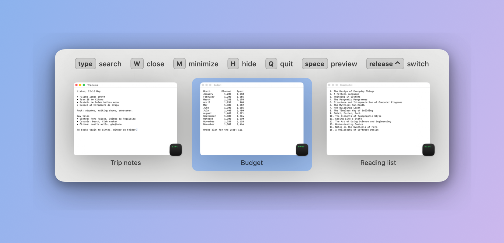
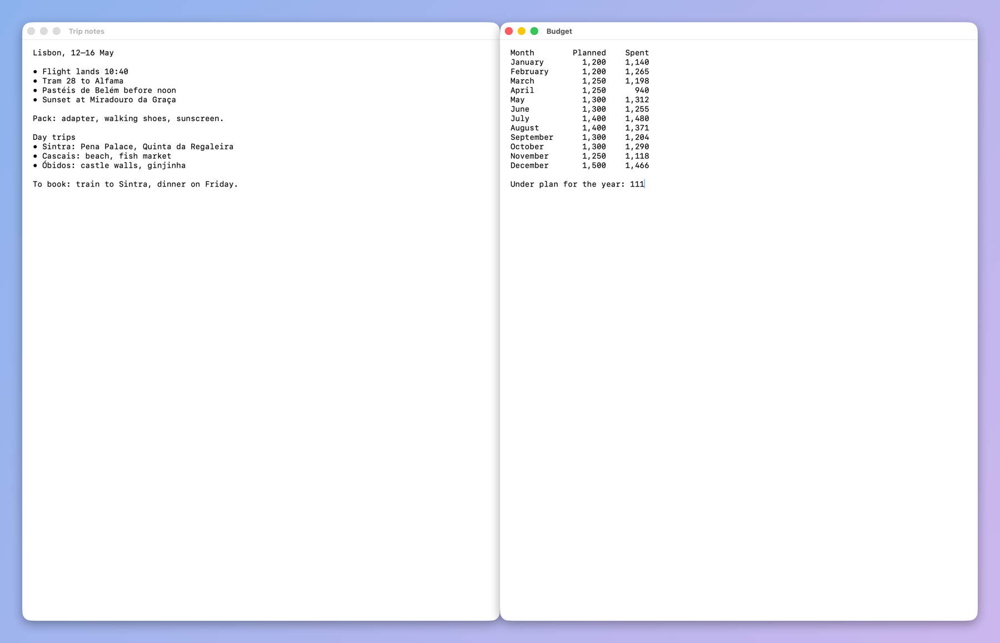
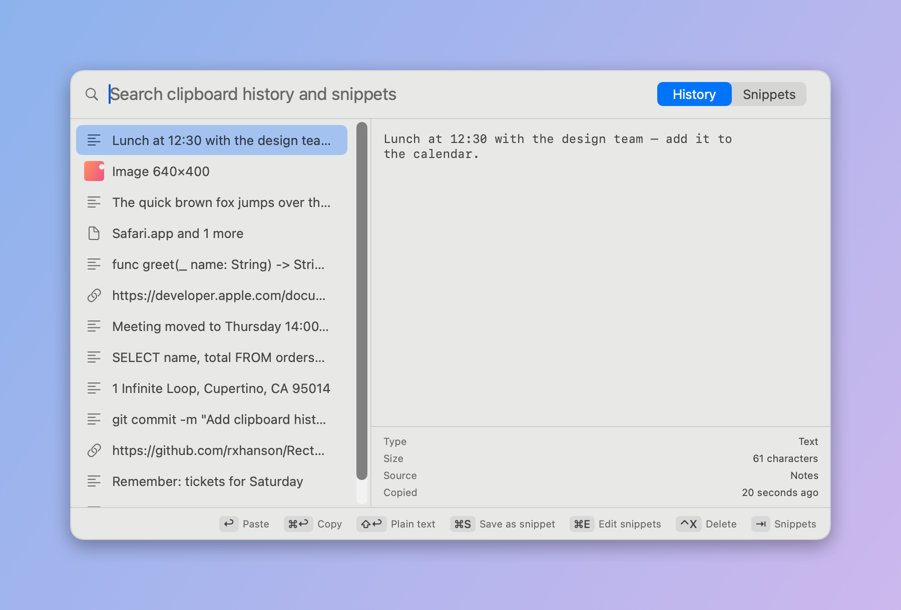
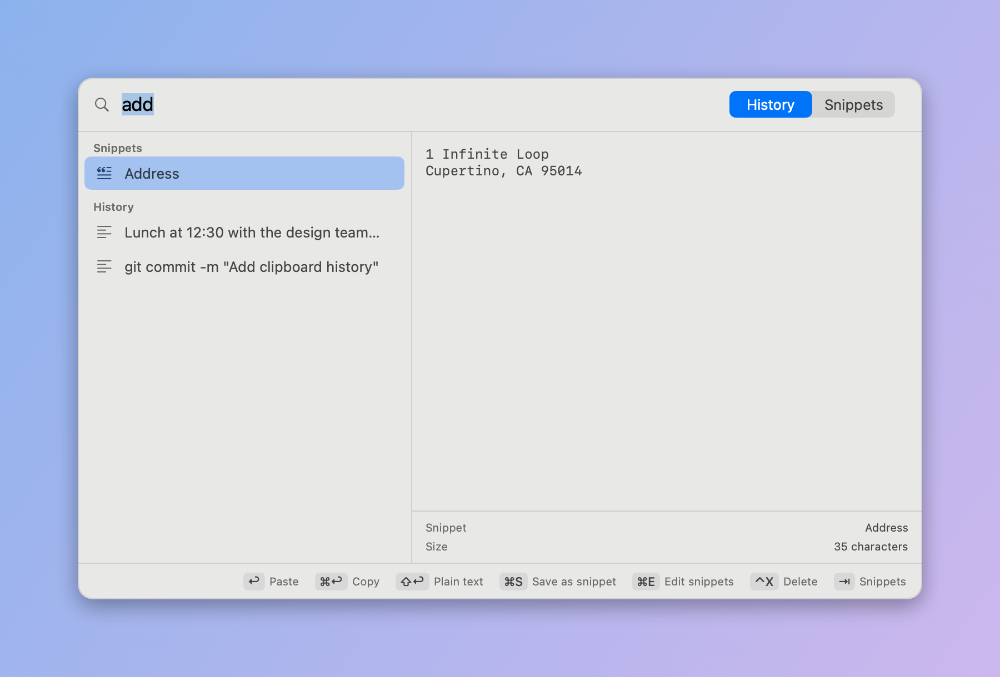
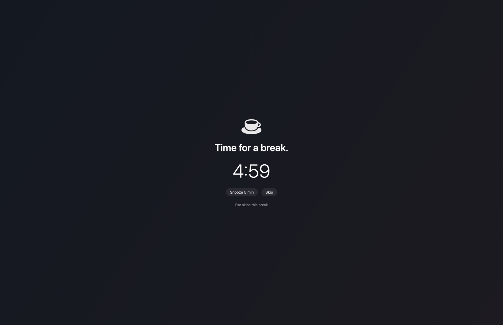
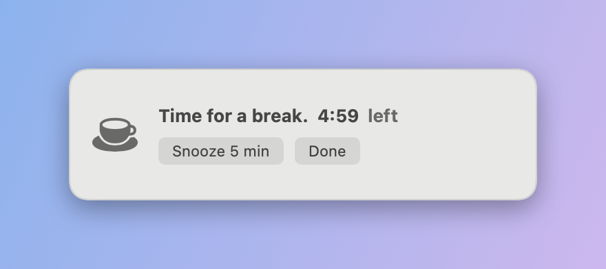
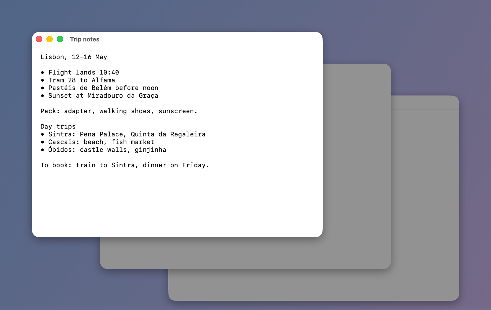
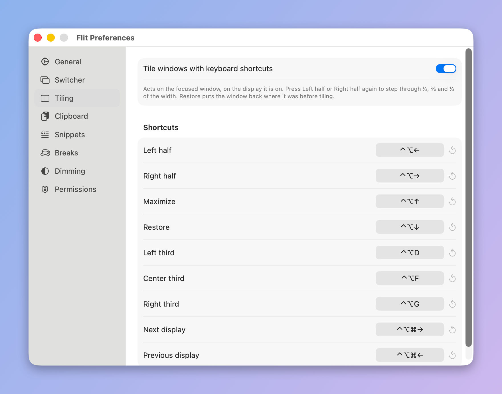

# flit

[](https://github.com/yohanko1/flit/actions/workflows/ci.yml)

A minimal all-in-one utility for macOS: one small native menu-bar app in
place of several single-purpose ones.



- **Window switcher** in the spirit of [AltTab](https://alt-tab.app/): hold ⌥,
  tap Tab, see every window as a thumbnail, release to focus.
- **Window tiling** like [Rectangle](https://rectangleapp.com/): halves,
  thirds, maximize, restore, send to the other display.
- **Clipboard history with snippets** like Raycast's: ⇧⌘V, pick, paste.
- **Break reminders** like [BreakTimer](https://breaktimer.app/).
- **Dimming** like [HazeOver](https://hazeover.com/): the front window stays
  bright, the rest of its display darkens.
- **Keep awake** like Caffeine: display on, Mac awake, optional timer.

Every feature can be switched off in Preferences; one that is off registers
no hotkeys and runs nothing.

The screenshots here are generated by `make screenshots` from a demo app and
sample data.

Requires macOS 14+ (built on 26) and only the Command Line Tools — no Xcode.

## Install

Build it yourself (recommended): the commands below sign the app with your
own identity, so the permissions you grant survive updates.

Or download `Flit-<version>.zip` from the
[latest release](https://github.com/yohanko1/flit/releases/latest), unzip, and
move `Flit.app` to `/Applications`. That build is signed ad hoc and not
notarized: open it the first time with right-click → Open, and expect to
grant the permissions again after each update.

## Build

```
make cert      # once: creates a self-signed "Flit Dev" signing identity so
               # the Accessibility / Screen Recording grants survive rebuilds
make install   # builds, signs, copies to /Applications, launches
make test      # unit tests (pure logic: filtering, tiling math, hotkeys,
               # clipboard store and rules, break timer, settings)
make selftest  # end-to-end: a debug build presses its own hotkeys against a
               # throwaway window and checks tiling, clipboard, dimming,
               # breaks, keep-awake, settings and memory. About 3 minutes;
               # keep your hands off the keyboard. `make selftest ONLY=dimming`
               # runs one part. Run `make install` afterwards.
make screenshots  # regenerates docs/screenshots from sample data and a demo app
```

On first launch grant **Accessibility** (required) in System Settings →
Privacy & Security. **Screen Recording** is optional: with it you get live
window thumbnails; without it each window is a card in its real shape with
the app icon and title, and Space outlines where the window is on screen.
(No API returns window pixels without that permission.) Flit retries the
event tap every 2 s until Accessibility is granted; no relaunch needed.
If a grant doesn't stick, remove Flit from the list, re-add it, relaunch.

macOS may also ask whether Flit may read the clipboard; choose Allow, or
clipboard history stays empty. The Permissions pane shows all three.

## Window switcher

| Keys (while holding ⌥) | Action |
|---|---|
| Tab / Shift-Tab, arrows | move selection |
| release ⌥ or Return | focus the selected window |
| Esc | cancel |
| ⌥ ` | switch between windows of the current app only |
| letters / digits | search by app name or title (subsequence match); the switcher turns **sticky** — release ⌥, keep typing, Return switches |
| ⌥ Space | open straight into sticky search (nothing to hold) |
| W / M / F / H / Q | close / minimize / fullscreen / hide app / quit app (when not searching) |
| Space | full-size preview of the selected window |
| mouse hover / click | select / focus |

Preferences live in the menu-bar icon: shortcut profiles with per-profile
filters (minimized, hidden, other Spaces, fullscreen, background tabs,
windowless apps, display scope, current-app-only), three styles (thumbnails, app icons, titles), theme,
size, which display, badges, app blacklist, launch at login, and an opt-in
replacement of the system ⌘-Tab.

## Window tiling



Acts on the focused window, on the display it is on. Shortcuts are
rebindable in Preferences → Tiling.

| Keys | Action |
|---|---|
| ⌃⌥← / ⌃⌥→ | left / right half; press again for ⅔, then ⅓, then ½ again |
| ⌃⌥↑ | maximize (fills the usable area, stays on the current desktop) |
| ⌃⌥↓ | restore the size and position from before tiling |
| ⌃⌥D / ⌃⌥F / ⌃⌥G | left / center / right third |
| ⌃⌥⌘→ / ⌃⌥⌘← | next / previous display, keeping the same tile |

## Clipboard history and snippets



⇧⌘V opens the panel on the newest copy. Text, links, images and copied
files are kept, in `~/Library/Application Support/Flit`, for a month by
default. Items that password managers mark as secret are skipped, and so are
copies made in apps you list under Preferences → Clipboard.

| Keys (panel open) | Action |
|---|---|
| ↑ / ↓ | move |
| Return | paste into the app you were in |
| ⌘Return | copy without pasting |
| ⇧Return | paste as plain text |
| type | search history and snippets; matching snippets come first |
| Tab | switch between History and Snippets |
| ⌘S | save the selected copy as a snippet |
| ⌘E | edit snippets in Preferences |
| ⌃X (or ⌘⌫ with an empty search) | delete the entry |
| Esc | clear the search, then close |

Snippets are edited in Preferences → Snippets. `{date}`, `{time}` and
`{clipboard}` in a snippet are filled in when it is pasted. A search lists
matching snippets ahead of matching copies:



## Break reminders



Every 28 minutes for 2 minutes by default. A small heads-up appears 30
seconds before (Start now / Snooze / Skip); the break then covers every
display, or shows as a small reminder if you prefer. Esc skips. Being away
from keyboard and mouse for 5 minutes, sleeping or locking the Mac restarts
the countdown. Working hours, message, sound, and whether skipping and
snoozing are allowed are in Preferences → Breaks. The menu-bar menu shows the
time to the next break and can start or pause one.

The small-reminder style:



## Dimming



Darkens everything behind the front window on that window's display; other
displays are not dimmed. Clicking the desktop lifts it. ⌃⌥⌘H or the menu-bar
menu toggles it; strength is in Preferences → Dimming.

## Keep awake

Keeps the display lit and the Mac awake until you turn it off, from the menu
or a hotkey you assign; "Keep Awake For" turns it off by itself. Closing the
lid with no external display still sleeps the Mac.

## Preferences

Open from the menu-bar icon. Each feature has a pane with its switch,
options and shortcuts; click a shortcut and press the new keys to change it.



## Hotkeys and other apps

Flit takes its hotkeys ahead of other apps. If Raycast or Rectangle has the
same combination, Flit's action runs and theirs does not, for as long as the
feature is on in Flit. To give a combination back, change or clear it in
Preferences, or switch the feature off.

## Layout

- `Sources/Flit/Model` — `WindowInfo`, `WindowFilter` (pure), `WindowStore` (enumeration + MRU)
- `Sources/Flit/System` — AX wrappers, dlsym-loaded private APIs (Spaces, ⌘-Tab hotkey, key-window trick), ScreenCaptureKit thumbnails, window actions
- `Sources/Flit/Input` — CGEvent tap, switcher shortcut profiles, one-shot hotkeys (`Hotkey`, `HotkeyCenter`)
- `Sources/Flit/Tiling` — `TileGeometry` (pure), `Tiler` (Accessibility)
- `Sources/Flit/Clipboard` — SQLite store, pasteboard watcher, panel, recording and polling rules (pure)
- `Sources/Flit/Breaks` — `BreakEngine` state machine (pure), controller, break screens
- `Sources/Flit/Dimming` — per-display overlays that follow the front window
- `Sources/Flit/App` — `SwitcherController` state machine, delegate, status bar, permissions, debug-only `SelfTest`
- `Sources/Flit/UI` — switcher and preview panels, SwiftUI views
- `Sources/Flit/Preferences` — settings model, window, per-feature panes, hotkey recorder
- `scripts/selftest.sh`, `scripts/selftest/Probe.swift` — the end-to-end self-test and its target window
- `scripts/screenshots.sh`, `Sources/Flit/App/Screenshooter.swift` — README screenshots (debug builds only)
- `docs/superpowers/specs` — the original switcher design spec

## License

MIT. See [LICENSE](LICENSE).
